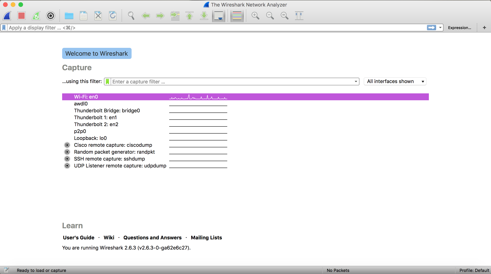
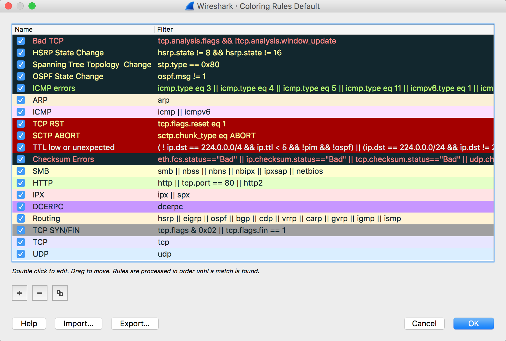
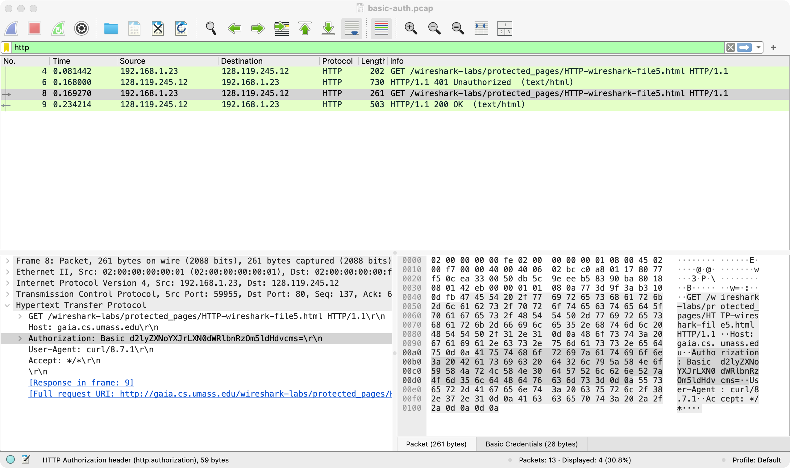

# Wireshark-Lab
By the end of this short lab, you should be very disappointed when you see this string of characters: `cGFzc3dvcmQ=`  

Slides from the talk: [Network Protocols.pdf](Network%20Protocols.pdf) (or [slides.txt](slides.txt) if you'd rather have plain text).  
<br/>
## What's a Wireshark?
Wireshark is a packet sniffer: it records the traffic going in and out of your computer and decodes it into something people can read.  Network admins use it to troubleshoot, security analysts use it to investigate attacks, and developers use it to see what their code is actually sending.  It provides a wealth of information on all packets it analyzes and includes a powerful filter feature so you can find exactly what you are looking for by filtering out certain traffic or protocols.  

## Let's get started
First, you'll need to download Wireshark:  
  
https://www.wireshark.org/download.html  
  
Get the latest stable release for your operating system (the 4.6 series as of November 2026).  

- **Windows:** Run the installer and keep the defaults.  Leave **Npcap** checked, since it's the driver that actually captures packets (without it you can open capture files, but you can't capture).  The installer will also offer **USBPcap**, the driver for capturing traffic on a USB device, which is fun if you want to plug your phone into your computer to see what it's up to.  You won't need it for this lab, though, and it requires a reboot.  
- **macOS:** There are separate downloads for Apple Silicon (Arm) and Intel Macs.  Not sure which you have?  Apple menu → About This Mac: "Apple M-something" means Arm.  Drag Wireshark into Applications, then install **ChmodBPF**, which gives Wireshark permission to capture.  Without it you'll see your interfaces, but capturing will fail with a permissions error.  Run this in Terminal, click through the installer, then quit and reopen Wireshark:  
  ```
  open "/Applications/Wireshark.app/Contents/Resources/Extras/Install ChmodBPF.pkg"
  ```
- **Linux (Debian/Ubuntu):** `sudo apt install wireshark`, answer **Yes** when it asks whether non-superusers should be able to capture packets, then run `sudo usermod -aG wireshark $USER` and log out and back in.  

**Can't install it, or capturing doesn't work?**  You can still do most of this lab.  Opening a saved capture file doesn't need any special permissions, so skip ahead to [Let's hack](#lets-hack) and start with Part 1.

## Your first capture
Now that you have Wireshark installed, go ahead and open it up.  On the home screen you will see a list of interfaces you can capture from, each with a little graph of its activity.  Pick the one that's actually moving, which is usually Wi-Fi (`en0` on a Mac) or Ethernet.  That is your Network Interface Card.  Macs also list a bunch of extra interfaces like `utun`, `awdl0` and `llw0`, which you can ignore.  
  
  
  
Double click it and capture packets for 10 to 20 seconds.  Visit a few websites or start a video so you get a variety of packets.  Click the red square stop button in the top left when you are ready to move on.  

## What in tarnation am I looking at here
There should be several packets on your screen now that we can experiment with.  Because of how much traffic there can be on networks, if you ever want to find what you're looking for here you will need to use filters.  In the filter bar at the top, try typing in different things like `dns`, `tcp`, `udp`, `quic` or `arp`, hit enter, and see what happens.  Notice that the filter bar turns green if your syntax is valid and red if it is not.  There's a whole [cheat sheet of filters](#filter-cheat-sheet) a little further down.  

What if you want to be able to see everything, but you just want to _highlight_ what you're looking for?  Then coloring rules are your friend!  Check out View → Coloring Rules to see what all the colors the packets have been highlighted as mean.  This is also a great place to get an example of the syntax for the filter bar, as the logic behind every coloring rule is simply a filter.  You will see that filters can be made to be as specific as you want them to be for whatever you need to do.  
  
  

There are three sections on the main screen.  The top one is the **packet list**.  When you click on a packet, the **packet details** section shows that packet decoded into readable fields, one layer at a time (Ethernet, then IP, then TCP or UDP, then whatever application protocol is inside).  The **packet bytes** section shows the raw bytes.  In newer versions of Wireshark those two sit side by side under the packet list; older versions stack them.  Click a field in the packet details and the bytes it came from light up in the packet bytes.  

### Filter cheat sheet
Here are some things to try in the filter bar.  Paste one in, hit Enter, and see what's left.  If nothing shows up, that kind of traffic just didn't happen during your capture.  Click the X at the right end of the bar to clear it.  

**By protocol**  

| Filter | What it shows |
|---|---|
| `dns` | Name lookups: every website name your computer asked about |
| `arp` | Devices on your local network asking "who has this IP address?" |
| `tls` | Encrypted HTTPS traffic |
| `quic` | HTTP/3 traffic, which runs over UDP |
| `icmp` | Pings, and the error replies `traceroute` relies on |
| `mdns` | Devices announcing themselves: printers, speakers, phones |
| `dhcp` | A device getting an IP address (turn your Wi-Fi off and on while capturing) |

**By address or port**  

| Filter | What it shows |
|---|---|
| `ip.addr == 128.119.245.12` | Everything to or from the lab's web server |
| `ip.src == 192.168.1.23` | Only packets sent _by_ that address.  Swap in your own IP (Mac: `ipconfig getifaddr en0`, Windows: `ipconfig`) |
| `ip.addr == 192.168.0.0/16` | Anything to or from an address on a typical home network |
| `tcp.port == 443` | HTTPS, by port number |
| `udp.port == 53` | DNS, by port number |

**By what's inside**  

| Filter | What it shows |
|---|---|
| `dns.qry.name contains "google"` | Lookups for any name with "google" in it |
| `tls.handshake.extensions_server_name contains "github"` | The start of every HTTPS connection to GitHub (you'll have some from reading this page) |
| `frame contains "password"` | Any packet with the word "password" anywhere in it.  Case-sensitive, and it only works on unencrypted traffic |
| `http.request.method == "POST"` | Forms being submitted over plain HTTP |
| `http.response.code == 404` | "Not Found" errors |
| `tcp.flags.syn == 1 && tcp.flags.ack == 0` | The first packet of every new TCP connection |
| `tcp.analysis.retransmission` | Packets that had to be sent again, a sign of a bad connection |
| `dns.flags.rcode == 3` | Lookups for names that don't exist |
| `frame.len > 1000` | Big packets, over 1,000 bytes |

**Combining filters**  
Use `and`, `or` and `not` (or `&&`, `||` and `!` if you prefer symbols), with parentheses to group things.  

| Filter | What it shows |
|---|---|
| `dns or arp` | Either one |
| `ip.addr == 128.119.245.12 and http` | Only the web traffic between you and the lab's server |
| `not (arp or mdns or ssdp)` | Everything except the background chatter |

**You don't have to memorize any of this.**  Click a packet, right-click any field in the packet details, and choose Apply as Filter → Selected.  Wireshark writes the filter for you, and you can see the syntax in the bar.  Prepare as Filter does the same thing without running it, so you can edit it first.  The bar also autocompletes: type `dns.` and it lists every DNS field it knows about.  

**One gotcha:** these are _display_ filters.  They only hide packets, so you can change or clear them any time.  The box above the interface list on the home screen is a _capture_ filter, which uses a different syntax and throws packets away before they're saved.  Leave that one empty for this lab.  

### Hey, where's all the HTTP?
Try the filter `http`.  You'll probably see very little, or nothing at all.  Almost every website now uses HTTPS (HTTP wrapped in TLS encryption) or HTTP/3 (which runs over QUIC, on UDP).  Both are encrypted, so Wireshark can see that you talked to a server, but not what you said.  

It can usually still see _who_ you talked to, though.  Try this filter:  
```
tls.handshake.extensions_server_name
```
Open one of those packets and find the **Server Name** field inside the Client Hello, then right-click it → Apply as Column.  That's the name of the website, which your computer sends unencrypted at the very start of every HTTPS connection.  Anyone on the network path can see which sites you visit, even over HTTPS.  Some sites now hide this with Encrypted Client Hello, so you may see a generic name like `cloudflare-ech.com` instead.  The same goes for the `dns` filter, which shows every name your computer looks up, unless your browser is using DNS over HTTPS.  

**Checkpoint questions**  
1. Find a DNS response in your capture.  What name was looked up, and what IP address came back?  
2. Does DNS run over TCP or UDP?  What port?  
3. Name three websites your computer talked to during the capture.  

<details>
<summary>Answers</summary>
<br>

1. It depends on your capture.  Filter on `dns`, click a packet whose Info column says "Standard query response", and expand Domain Name System → Answers.  
2. UDP, port 53.  It's right there in the packet details under User Datagram Protocol.  
3. Use the `tls.handshake.extensions_server_name` column you just made.  
</details>

## Let's hack
Every packet you capture contains an immense amount of information.  For this part, we are going to pull a username and password out of a packet capture.  

First, some background.  When you log in to a page protected by **HTTP Basic authentication**, your client sends this header with every request:  
```
Authorization: Basic <your username:password, Base64-encoded>
```
Base64 is an **encoding**, not encryption.  It just turns bytes into printable characters so they fit in a header.  There is no key, and anyone can turn it back.  The only thing protecting that header is HTTPS.  Over plain HTTP, Basic auth is the same as sending your password in plain text.  

### Part 1: Someone else's capture
Download [`captures/basic-auth.pcap`](captures/basic-auth.pcap) from this repo (on GitHub, open the file and click the download button) and open it in Wireshark with File → Open.  Someone logged in to a password-protected page while this was being recorded.  Find their username and password.  

<details>
<summary>If you need help finding the packet, click here</summary>
<br>
Enter `http` in the filter bar.  There are two GET requests.  The server rejects the first one with `401 Unauthorized`, and its `WWW-Authenticate` header tells the client to use Basic authentication.  Open the second GET and expand `Hypertext Transfer Protocol`.  The `Authorization` line is the one you want.  
  
 
</details>

Got the string after `Authorization: Basic`?  Decode it yourself:  

- macOS / Linux:  
  ```
  echo 'PASTE-THE-STRING-HERE' | base64 --decode
  ```
- Windows (PowerShell):  
  ```
  [Text.Encoding]::UTF8.GetString([Convert]::FromBase64String('PASTE-THE-STRING-HERE'))
  ```

Now click the little arrow next to the `Authorization` line in Wireshark.  It already decoded it for you.  That's how little protection Base64 gives you.  Now scroll back up to the top of this page and decode `cGFzc3dvcmQ=`.  Disappointed yet?  

**Checkpoint questions** (all from `basic-auth.pcap`)  
1. Which three packets are the TCP three-way handshake?  What flags does each one have?  
2. What port is the web server listening on?  
3. What status code did the server send back the _first_ time, and why?  

<details>
<summary>Answers</summary>
<br>

1. Packets 1, 2 and 3: SYN, then SYN-ACK, then ACK.  Try the filter `tcp.flags.syn == 1`.  The extra ECE and CWR flags on the first two are the computers agreeing to use Explicit Congestion Notification, a way for routers to say "slow down" without dropping packets.  
2. Port 80, the standard port for plain HTTP.  
3. `401 Unauthorized`, because the first request didn't include any credentials.  The `WWW-Authenticate: Basic` header tells the client how to log in, and the client tries again with an `Authorization` header.  This is the same thing your browser does when it pops up a login box.  
</details>

### Part 2: Capture it yourself
**MAKE SURE YOU BEGIN A NEW CAPTURE BEFORE PROCEEDING**  

Then run this in a terminal.  This test page and its credentials (`wireshark-students` / `network`) are published by the authors of _Computer Networking: A Top-Down Approach_ for exactly this kind of exercise.  

macOS / Linux:  
```
curl --anyauth -u wireshark-students:network http://gaia.cs.umass.edu/wireshark-labs/protected_pages/HTTP-wireshark-file5.html
```
Windows (type `curl.exe`, not `curl`, because in PowerShell plain `curl` is a different command):  
```
curl.exe --anyauth -u wireshark-students:network http://gaia.cs.umass.edu/wireshark-labs/protected_pages/HTTP-wireshark-file5.html
```

You should see "This page is password protected!" and "Congratulations!".  

**AFTER YOU SEE THE CONGRATULATIONS MESSAGE, END THE CAPTURE**  

Now find your own password in your own capture, just like in Part 1.  

### Part 3: Now try it in a browser
Start another new capture, open the same link in your web browser, and log in with the same username and password:  

http://gaia.cs.umass.edu/wireshark-labs/protected_pages/HTTP-wireshark-file5.html  

Stop the capture and filter on `http` again.  What do you see?  

<details>
<summary>What happened?</summary>
<br>
Most likely nothing.  Modern browsers quietly upgrade <code>http://</code> links to <code>https://</code> whenever the server supports it, and this one does.  Your password still crossed the network, but inside TLS, where Wireshark can't read it.  To see the encrypted connection instead, try:  
<br><br>
<code>tls.handshake.extensions_server_name contains "gaia"</code>
<br><br>
This is exactly why browsers made HTTPS the default.  When this lab was first written in 2018, this step showed your password in plain text.  If you <em>did</em> find your password, your browser didn't upgrade the connection.  Check the address bar and you'll see it's still on <code>http://</code>.  
</details>

## Bonus: Star Wars over telnet
Telnet is the remote login protocol people used before SSH, and just like HTTP it sends everything (passwords included) as plain text.  Start a capture, then:  

- macOS / Linux: `nc towel.blinkenlights.nl 23` (press Ctrl+C to quit)  
- Windows: turn on **Telnet Client** under "Turn Windows features on or off", then run `telnet towel.blinkenlights.nl` (press Ctrl+] and type `quit` to exit)  

Enjoy the show for a bit, then go back to Wireshark, filter on `tcp.port == 23`, right-click any packet and choose Follow → TCP Stream.  Everything the server sent you is right there.  

## Going further
**For the security folks**  
- **File → Export Objects → HTTP:** pull the actual files (pages, images, downloads) back out of a capture.  Try it on your Part 2 capture.  
- **Practice captures:** the Wireshark wiki keeps a library of [sample captures](https://wiki.wireshark.org/SampleCaptures) covering dozens of protocols, plus some real attacks to pick apart.  

**For the systems folks**  
- **Analyze → Expert Information:** Wireshark's own list of problems it noticed, like retransmissions, resets and malformed packets.  A quick health check for any capture.  
- **Filter on `tcp.analysis.flags`:** every TCP packet Wireshark thinks something went wrong with.  A few are normal, but lots of them point to a bad connection.  

**For the data folks**  
- **Statistics → Protocol Hierarchy:** what share of your traffic was QUIC vs. TLS vs. DNS?  
- **Statistics → Conversations:** which hosts did your computer talk to the most, and how many bytes were exchanged?  
- **Statistics → I/O Graphs:** traffic over time.  Start a video mid-capture and watch it jump.  
- **Get it into pandas:** File → Export Packet Dissections → As CSV, or use `tshark`, the command-line version of Wireshark that ships with it:  
  ```
  tshark -r capture.pcapng -T fields -E header=y -E separator=, -e frame.time_relative -e ip.src -e ip.dst -e _ws.col.Protocol -e frame.len > packets.csv
  ```
  On a Mac, `tshark` lives in `/Applications/Wireshark.app/Contents/MacOS/` unless you also ran the "Add Wireshark to the system path" installer in the same Extras folder as ChmodBPF.  

## Use your powers for good, not evil
As you can see, Wireshark is a very powerful network analysis tool.  Only capture traffic on networks you own or have explicit permission to monitor.  Capturing other people's traffic without authorization can break wiretapping laws, and it will almost certainly break your school's or employer's acceptable-use policy.  On modern switched and WPA2/WPA3 networks, a normal capture mostly shows your own traffic plus some broadcasts anyway, which is all you need for this lab.  I hope you enjoyed this quick look into networks and analyzing them!
